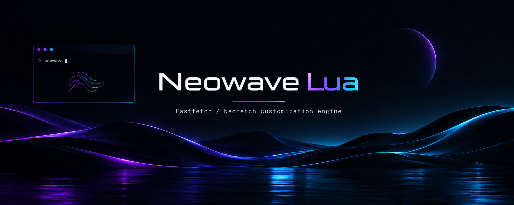
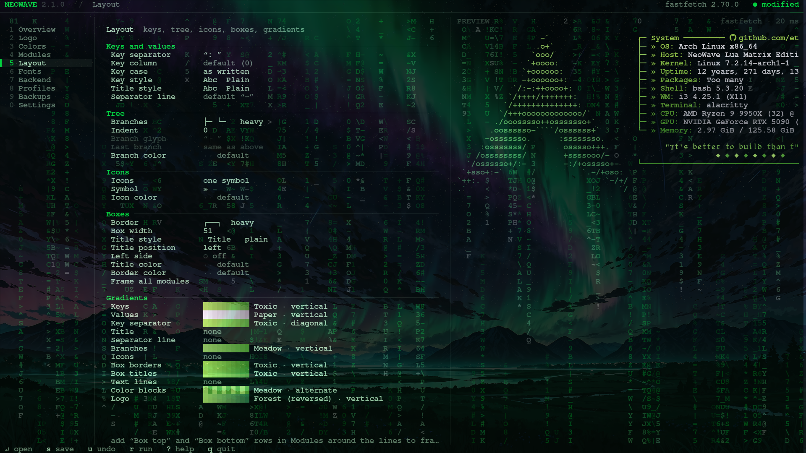
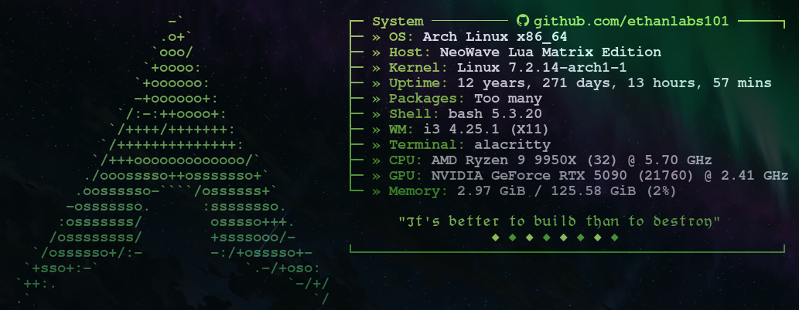

## Code + Installer coming very soon!

***I'm currently working on this (11/09/2026)***

## Preview

> **Modular terminal customization engine for Neofetch & Fastfetch.**  
> The Lua successor to the legacy Bash NeoWave — built for flexibility, safety, and cross-distro polish.
 
---
 
## License

This project is licensed under the MIT License — see [LICENSE](https://github.com/ethanlabs101/neowave-lua/blob/main/LICENSE) for details.
